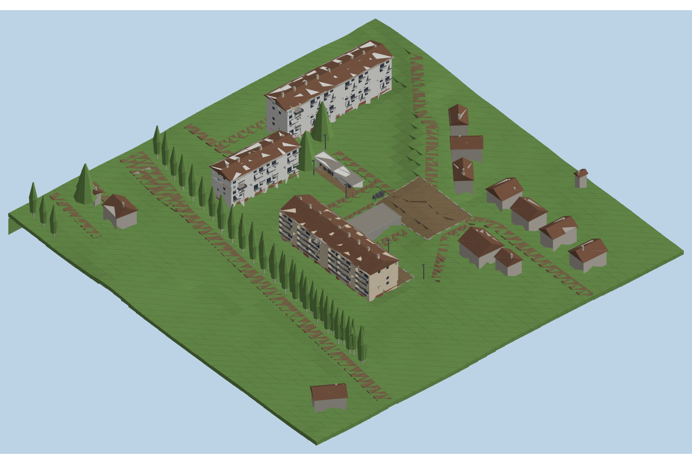

# zm_seyssel — map zombies Black Ops III

Map custom pour le mode Zombies de **Call of Duty: Black Ops III**, qui recrée la ville de **Seyssel (Haute-Savoie)**.
On commence par le quartier des **Prés Dombet** et ses trois immeubles HLM.



## Avancement

| # | Zone | État |
|---|---|---|
| 01 | [Bâtiment 1 (HLM, 3 halls, R+4)](docs/batiments/01-hlm-pres-dombet.md) | Façades, 3 halls crème, escaliers, ascenseur scripté, 1 appartement jouable |
| 02 | Bâtiment 2 (démoli, état 2023 : 2 halls, R+4) | Façades, 2 halls, escaliers, 1 appartement jouable |
| 03 | Bâtiment 3 (3 halls, R+5) | Façades, 3 halls, escaliers, 1 appartement jouable |
| 04 | Terrain (relief IGN), parkings haut et bas, annexe, garages, voirie | Fait |
| 05 | Végétation (peupliers, sapins, feuillus), voitures, mobilier | Fait, à affiner |
| 06 | Textures photo des façades | À faire |
| 07 | École maternelle, maisons voisines détaillées | Volumes simples |

## Ce qu'il faut

- Black Ops III sur Steam
- **Call of Duty: Black Ops III - Mod Tools** (gratuit, Steam > Bibliothèque > filtre « Outils »)
- Git et Python 3 (pour regénérer les plans)

## Organisation du dépôt

```
game/                       copie des sources de la map, même arborescence que le dossier du jeu
  map_source/zm/zm_seyssel.map                 map principale (gameplay, ascenseur, volumes, ciel)
  map_source/_prefabs/zm_seyssel/quartier.map  terrain, voirie, végétation, voisins (généré)
  map_source/_prefabs/zm_seyssel/batiment_*.map les trois immeubles (générés)
  usermaps/zm_seyssel/      scripts (dont l'ascenseur), zone_source, sons
docs/
  batiments/                une fiche par bâtiment (photos décrites, dimensions, ordre de construction)
  gameplay/                 parcours, portes, atouts, Mystery Box par zone
  plans/                    plan de dessus, aperçu 3D et coordonnées en unités Radiant
reference/osm/              données OpenStreetMap du quartier (+ bâtiment 2 et garages d'après l'historique 2018)
reference/ign/              relief IGN RGE ALTI (grille de 4 m)
reference/photos/           tes photos perso (non publiées sur GitHub)
tools/
  build_map.py              génère toute la map (appelle quartier.py et immeuble.py)
  quartier.py               terrain, parkings, routes, annexe, garages, voisins, végétation, montagnes
  immeuble.py               immeubles HLM : façades, halls, escaliers, appartement jouable, ascenseur
  geo.py                    projection en unités de jeu, relief IGN
  compile.ps1               compile (BSP, éclairage, link) et lance le jeu
  sync.ps1                  copie dépôt <-> dossier des Mod Tools
  preview_blockout.py       aperçu 3D / plans d'étage à partir des .map
  make_blockout.py          briques géométriques et écriture des .map
  osm_to_plan.py            plan de dessus et coordonnées (premier relevé)
```

## Ce qu'il y a dans la map

- **Trois immeubles** : bâtiment 1 beige (loggias et panneaux bruns côté halls, balcons filants à l'arrière), bâtiments 2 et 3 blancs (balcons en saillie au sud, halls au nord).
- **Halls** identiques : entrée vitrée avec auvent, boîtes aux lettres, escalier à deux volées, paliers ; sols et marches couleur crème, murs crème.
- **Ascenseur** dans le hall du milieu du bâtiment 1 : bouton dans la cabine (étage suivant) et bouton d'appel à chaque palier.
- **Un appartement jouable par immeuble** (entrée, cuisine, salle de bain, deux chambres, séjour avec balcon), éclairé, prêt à être meublé.
- **Terrain réel** (relief IGN) : le parking du haut est ~2,5 m au-dessus du parking qui longe le bâtiment 1.
- **Rendu** : ciel et soleil de jour, étalonnage neutre, éclairage calculé en qualité moyenne, sondes de reflets dans les halls et les appartements.

Les prefabs générés peuvent être ouverts dans Radiant, mais ils sont réécrits à chaque `build_map.py` : les ajouts faits à la main vont dans la map principale ou dans un prefab à part.

## Travailler sur la map

```powershell
# après avoir récupéré les dernières modifs
git pull
.\tools\sync.ps1 -Vers Jeu

# ... travailler dans Radiant, compiler avec le Launcher ...

# avant d'enregistrer ton travail
.\tools\sync.ps1 -Vers Depot
git add .
git commit -m "HLM : façade est"
git push
```

Avec Claude Code, ces étapes sont automatiques : à la fin de chaque réponse, `tools/fin-de-session.ps1` récupère la map depuis le jeu, puis fait le commit et le push s'il y a des changements. On peut aussi le lancer à la main.

Le dossier des Mod Tools par défaut est `D:\SteamLibrary\steamapps\common\Call of Duty Black Ops III 455130` ; sinon passe `-Bo3 "<chemin>"`.

## Fabriquer, compiler et jouer

```powershell
python tools/build_map.py        # (re)génère zm_seyssel.map et le prefab du quartier depuis le modèle zombies
.\tools\sync.ps1 -Vers Jeu       # copie vers le dossier des Mod Tools
.\tools\compile.ps1              # base des assets, BSP + navmesh, éclairage, link, puis lance le jeu
.\tools\compile.ps1 -Etapes Jouer   # relancer sans recompiler
```

Pièges réglés par `compile.ps1`, à connaître si tu passes par le Launcher :

- **Langue du jeu.** Un BO3 en français charge `fr_zm_seyssel.ff`. Si la map est liée en anglais, le jeu s'arrête avec `Could not find zone 'fr_zm_seyssel'`. Le script détecte la langue du jeu installé ; dans le Launcher, règle « Build Language » sur la langue de ton jeu.

- **Mod Tools dans un dossier à part.** Steam les a mis dans `Call of Duty Black Ops III 455130`, à côté du jeu. Le bouton « Run » du Launcher cherche `BlackOps3.exe` dans ce dossier et ne le trouve pas. Le script lance le jeu depuis son vrai dossier, où un lien `usermaps` pointe vers celui des Mod Tools.
- **Windows en français.** L'outil `gdtdb` lit les décimaux à la française (« 0,5 ») et plante sur les fichiers BO3 (« 0.5 »). Le script le lance en anglais, sans rien changer à Windows.
  Le compilateur de sons intégré au linker a le même défaut, et là aucun contournement n'est possible : tant que le symbole décimal de Windows est la virgule, le link signale `unable to load file 'sound/zone//zm_seyssel.all.alias.sz'`. La map compile et se lance quand même, mais sans sons personnalisés. Correctif : `Win + R` → `intl.cpl` → **Paramètres supplémentaires** → **Symbole décimal** = `.` (et **Symbole de groupement des chiffres** = espace).

## Échelle

1 unité BO3 = 1 pouce = 2,54 cm. Le quartier entier est agrandi de 25 % (`ECHELLE` dans `tools/geo.py`, 1 m réel ≈ 49 unités) : à l'échelle exacte, tout paraît petit en jeu, les maps officielles font pareil. Les immeubles sont en plus élargis (×1,6 au total en profondeur). Hauteur d'étage : 144 unités.

## Crédits

- Emprises des bâtiments et routes : © contributeurs [OpenStreetMap](https://www.openstreetmap.org/copyright), licence ODbL (source cadastre DGFiP).
- Les images Google Maps / Street View servent seulement de référence visuelle et ne sont pas incluses dans ce dépôt.
