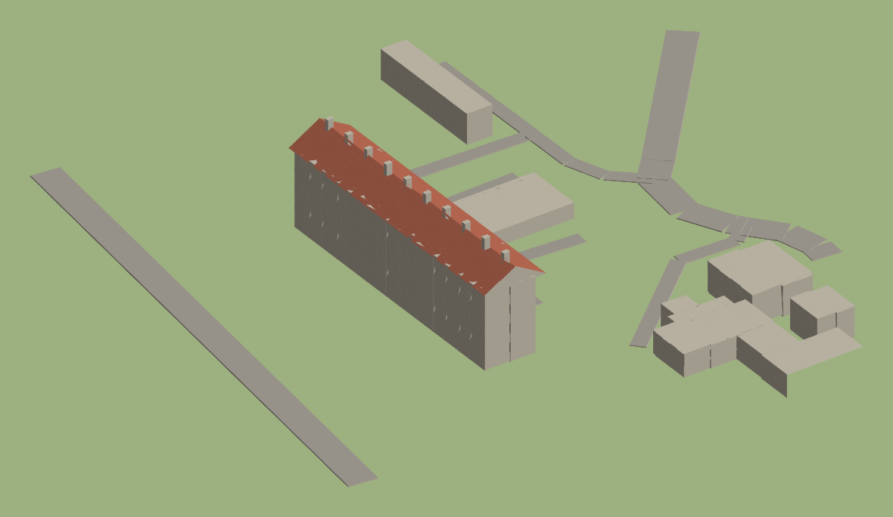

# zm_seyssel — map zombies Black Ops III

Map custom pour le mode Zombies de **Call of Duty: Black Ops III**, qui recrée la ville de **Seyssel (Haute-Savoie)**.
On commence par le quartier des **Prés Dombet** et son HLM, qui sert de zone de départ.



## Avancement

| # | Zone | État |
|---|---|---|
| 01 | [HLM des Prés Dombet](docs/batiments/01-hlm-pres-dombet.md) | Relevé fait, prefab de blockout généré — à tester dans Radiant |
| 02 | Annexe à toit plat + parking | À faire |
| 03 | Avenue Borcier (peupliers) | À faire |
| 04 | École maternelle | À faire |
| 05 | Barre nord (Chemin de la Fontaine) | À faire |

## Ce qu'il faut

- Black Ops III sur Steam
- **Call of Duty: Black Ops III - Mod Tools** (gratuit, Steam > Bibliothèque > filtre « Outils »)
- Git et Python 3 (pour regénérer les plans)

## Organisation du dépôt

```
game/                       copie des sources de la map, même arborescence que le dossier du jeu
  map_source/zm/zm_seyssel.map
  map_source/_prefabs/zm_seyssel/site_blockout.map   blockout du quartier, prêt à importer
  usermaps/zm_seyssel/      scripts, zone_source, sons
docs/
  batiments/                une fiche par bâtiment (photos décrites, dimensions, ordre de construction)
  gameplay/                 parcours, portes, atouts, Mystery Box par zone
  plans/                    plan de dessus, aperçu 3D et coordonnées en unités Radiant
reference/osm/              données OpenStreetMap du quartier
reference/photos/           tes photos perso (non publiées sur GitHub)
tools/
  sync.ps1                  copie dépôt <-> dossier du jeu
  osm_to_plan.py            regénère le plan de dessus et les coordonnées
  make_blockout.py          regénère le prefab de blockout
  preview_blockout.py       regénère l'aperçu 3D à partir d'un .map
```

## Importer le blockout dans Radiant

1. `.\tools\sync.ps1 -Vers Jeu` pour copier le prefab dans le dossier du jeu.
2. Dans Radiant, ouvrir `zm_seyssel`, clic droit dans la vue 2D > **Misc > Prefab...**, choisir `_prefabs/zm_seyssel/site_blockout.map`.
3. Placer le prefab en (0, 0, 0). Le HLM est centré sur l'origine, le sol est à z = 0.

Le prefab contient le sol, les routes, le HLM (5 niveaux de 128, toit à deux pans, cheminées), l'annexe et les bâtiments voisins en volumes simples.

## Travailler sur la map

```powershell
# après avoir récupéré les dernières modifs
git pull
.\tools\sync.ps1 -Vers Jeu

# ... travailler dans Radiant, compiler avec le Launcher ...

# avant d'enregistrer ton travail
.\tools\sync.ps1 -Vers Depot
git add .
git commit -m "HLM : façade est"
git push
```

Avec Claude Code, ces étapes sont automatiques : à la fin de chaque réponse, `tools/fin-de-session.ps1` récupère la map depuis le jeu, puis fait le commit et le push s'il y a des changements. On peut aussi le lancer à la main.

Le chemin du jeu par défaut est `D:\SteamLibrary\steamapps\common\Call of Duty Black Ops III` ; sinon passe `-Bo3 "<chemin>"`.

## Échelle

1 unité BO3 = 1 pouce = 2,54 cm, donc 1 m ≈ 39,4 unités. Les emprises des bâtiments viennent du cadastre ; la hauteur d'étage est fixée à 128 unités pour que le jeu reste confortable.

## Crédits

- Emprises des bâtiments et routes : © contributeurs [OpenStreetMap](https://www.openstreetmap.org/copyright), licence ODbL (source cadastre DGFiP).
- Les images Google Maps / Street View servent seulement de référence visuelle et ne sont pas incluses dans ce dépôt.
