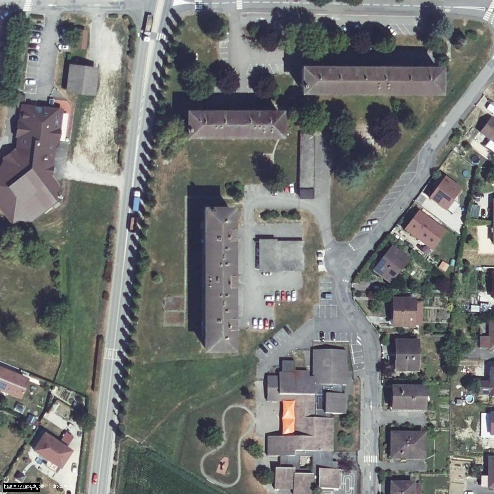
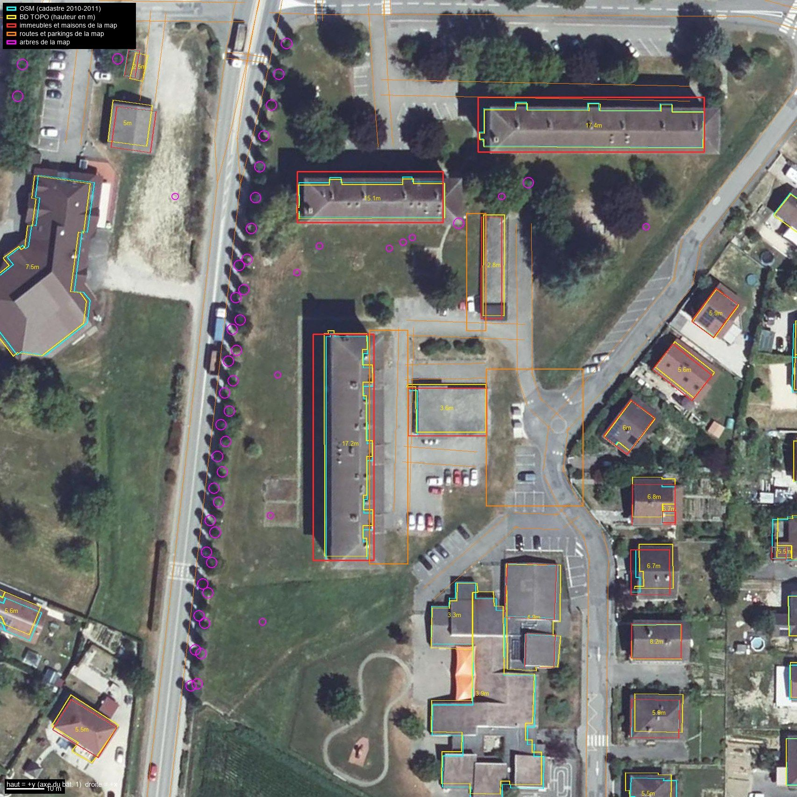
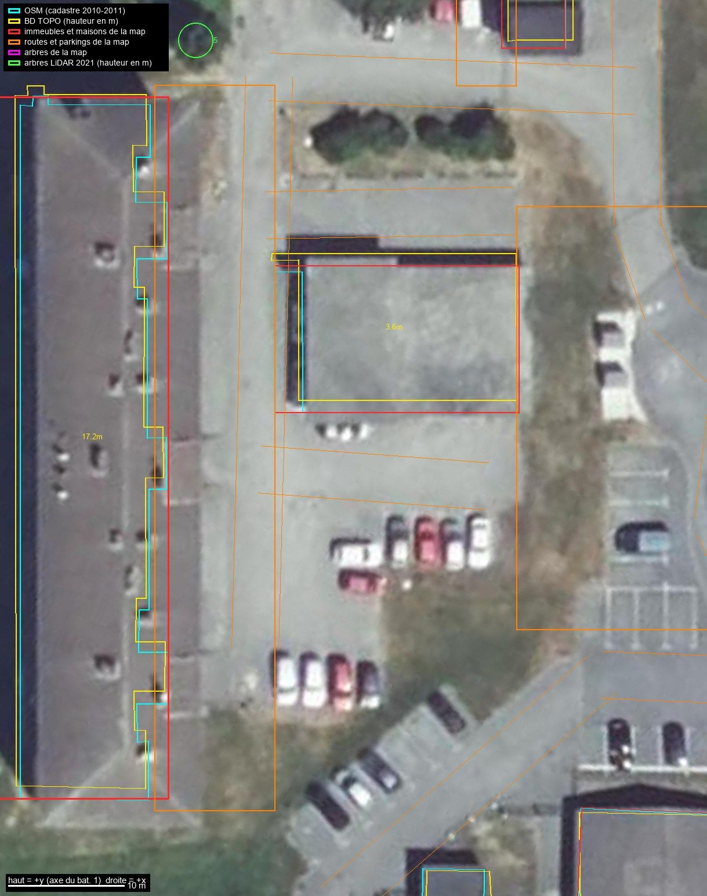
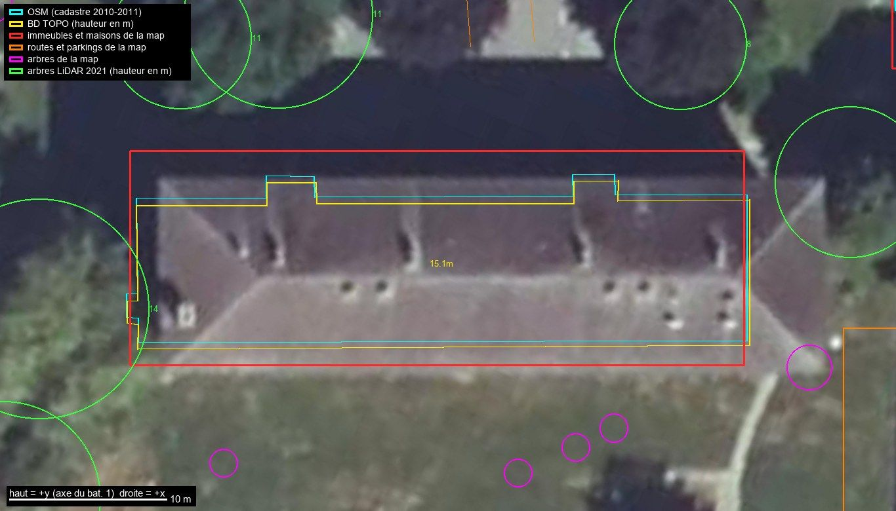
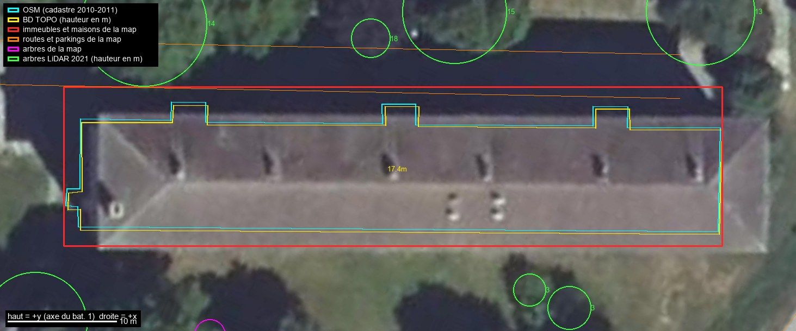
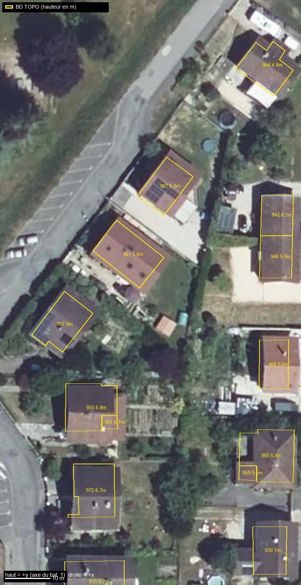
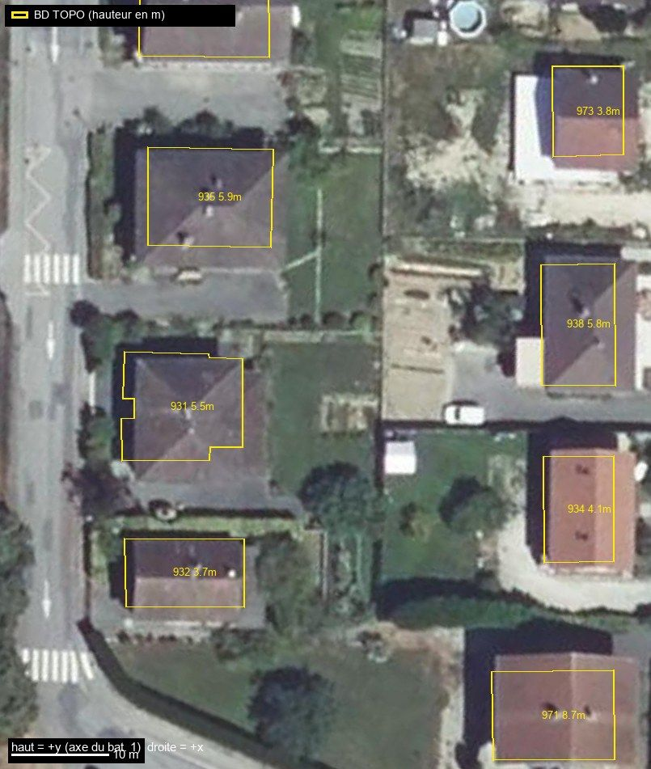
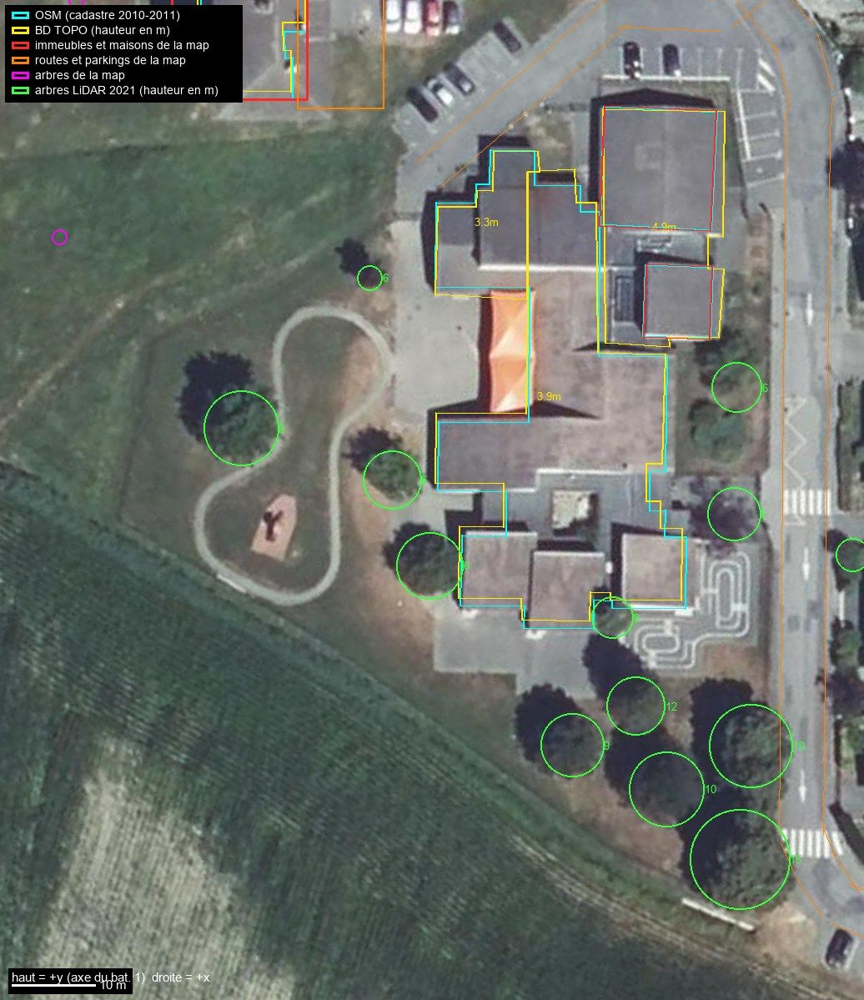

# Vue aérienne et données ouvertes IGN : le quartier réel contre la map générée

Relevé du 24 octobre 2026 sur les données ouvertes de l'IGN (Géoplateforme, sans clé, Licence Ouverte Etalab 2.0, © IGN). Ce document compare le quartier réel (orthophoto, BD TOPO, LiDAR HD) à ce que génèrent `tools/quartier.py` et `tools/immeuble.py`. Il complète [`facades-et-alentours.md`](facades-et-alentours.md), qui est fait à hauteur d'homme (Street View) ; ici tout est vu **de dessus** ou **mesuré**.

Étiquettes utilisées pour chaque affirmation :

- **[IGN]** : donnée vectorielle BD TOPO (WFS), mesurée par l'IGN (précision planimétrique annoncée 1 à 3 m selon l'objet, en pratique ≈ 0,5 m ici).
- **[LIDAR]** : mesure LiDAR HD de l'IGN (grille de 0,5 m, acquisition des 13 et 14 juin 2021), traitée par `tools/ign_vues.py`.
- **[ORTHO]** : lu à l'œil sur l'orthophoto (vol du 22 août 2023). Précision de lecture ≈ 0,5 à 1 m, plus pour les toits hauts (voir 1.3).
- **[DÉDUIT]** : calcul ou interprétation à partir de ce qui précède. Peut être faux.
- **[INCONNU]** : non visible de dessus. Ne pas inventer.

Repère : celui de `tools/geo.py` (origine au centre du bâtiment 1, axe Y le long du bâtiment 1, 1 m réel = 49,2125 unités). Toutes les coordonnées `(x, y)` ci-dessous sont en unités de jeu, arrondies à ±50 unités (≈ 1 m) quand elles sont lues sur une image.

## 0. À retenir

1. **Les trois toits sont en croupe (4 pans), pas à deux pans.** Visible sur l'orthophoto (arêtiers aux deux bouts) et mesuré au LiDAR (le faîtage descend de 3 m sur les 5 derniers mètres). Pente mesurée **22°** pour les trois (la map : 24° / 18° / 18°). **Contredit** la ligne « pignons droits » de `facades-et-alentours.md` (2.2) : à trancher, voir 5.
2. **Les immeubles de la map sont trop profonds de 3 à 3,5 m** (16,3 / 13,7 / 14,6 m contre 12,9 / 10,6 / 11,5 m au cadastre, halls compris) et leur toit trop large de 3 à 4 m. C'est l'élargissement ×1,28 de `immeubles_hlm()`, demandé à l'époque pour le gameplay : à garder ou non est une décision, pas une erreur.
3. **Le grand parking est quasi absent.** L'enrobé réel couvre à peu près x 450 à 1850, y -1000 à 2100 (28 × 63 m) ; la map ne goudronne qu'une bande de 10 m le long de la façade. Le « parking du haut » de la map (x 1792 à 3072, y -768 à 1024) recouvre à la fois le talus herbeux, la route et le rond-point ; le vrai stationnement à places marquées, à 256,7-257 m, est plus au sud (x 2080 à 3050, y -1450 à -50).
4. **Végétation : 135 arbres réels (≥ 2,5 m) contre 55 dans la map**, et presque aucun n'est au bon endroit en dehors des peupliers. Les grands conifères de l'est du parking et la rangée de 11 arbres de 9,5 à 21 m au nord des bâtiments 2 et 3 manquent. Les peupliers de la map font 17 à 22 m ; les vrais, 8 à 10 m en 2021 et environ 10 à 12 m en 2023.
5. **L'école maternelle est absente** : le terrain s'arrête à y = -4608, l'école va jusqu'à y ≈ -6300. La Maison de Pays (ouest) est coupée de la même façon.
6. **Les maisons** ont la bonne emprise, la bonne orientation de faîtage (8 sur 9) et à peu près la bonne hauteur (faîtage réel de 7,0 à 9,9 m, moyenne 8,2 m ; la map ≈ 9,6 m). Il leur manque la variété : toits à croupes ou mixtes (la map ne fait que des deux pans de 32°), deux familles de couleurs (ardoise grise, terre cuite), panneaux solaires, annexes, jardins.
7. **Le relief est bon** : la grille IGN 4 m utilisée par la map s'écarte du LiDAR de 0,12 m en moyenne (écart-type 0,27 m). Aucun besoin d'y toucher.
8. **Impossible de voir les balcons arrière de dessus.** Le LiDAR ne donne que le bord du toit, qui coïncide avec le trait cadastral ouest (à 0,2 m près). La profondeur des balcons reste [INCONNU] (voir `facades-et-alentours.md`, 2.5).

Liste priorisée complète : section 4.

## 1. Sources, méthode, limites

### 1.1 Ce qui a été téléchargé

| Donnée | Service | Détail | Où |
|---|---|---|---|
| Orthophoto | WMS-R `data.geopf.fr/wms-r`, couche `ORTHOIMAGERY.ORTHOPHOTOS` (= « Ortho 20 cm », BD ORTHO V3) | vol du **22 août 2023** pour la Haute-Savoie (déduit de la couche de mosaïquage `ORTHOIMAGERY.ORTHOPHOTOS.GRAPHE.2021-2023`) | `_build/ref/wms/`, `_build/ref/vues/` |
| BD TOPO V3 | WFS `data.geopf.fr/wfs/ows`, 16 couches | version en ligne le 24/10/2026 | `_build/ref/wfs/` → `reference/ign/bdtopo_quartier.json` |
| LiDAR HD | WMS-R, couches MNH / MNS / MNT, EPSG:2154, flottants 32 bits | grille 0,5 m, 500 × 500 m autour du bâtiment 1, acquisition du **13-14 juin 2021** (mission 21LHD5PK1, métadonnées `IGNF_LIDAR-HD_METADONNEE`) | `_build/ref/*.bil` → `reference/ign/lidar_quartier.json` |

**Résolution.** L'ortho est à **20 cm natifs**. Un essai à 2 cm par pixel (demandé) donne une image floue : c'est de l'interpolation, sans information en plus. Les vues du dépôt sont rendues à 8 à 24 pixels par mètre (4 à 12 cm par pixel), ce qui suffit pour lire un toit, une voiture, un marquage, pas un détail de 10 cm.

**Requêtes WFS (pour mémoire).** Trois façons de filtrer ont été essayées en WFS 2.0.0. `BBOX=lat_min,lon_min,lat_max,lon_max,EPSG:4326` (ordre lat,lon) renvoie une collection **vide**. `BBOX=lon_min,lat_min,lon_max,lat_max,EPSG:4326` (ordre lon,lat) et `CQL_FILTER=BBOX(geometrie,lat_min,lon_min,lat_max,lon_max)` (ordre lat,lon, celui qu'utilise `ign_donnees.py`) renvoient les mêmes 373 bâtiments. La sortie GeoJSON est en lon,lat. Le serveur renvoie les accents doublement encodés (corrigé dans `ign_donnees.py`).

### 1.2 Fichiers produits

| Fichier | Contenu |
|---|---|
| `reference/ign/bdtopo_quartier.json` (51 Ko) | 99 bâtiments (emprise en unités de jeu, usage, hauteur, niveaux, logements, codes matériaux, altitudes sol/toit, `z_sol_jeu`, rôle `bat1/bat2/bat3/annexe/garages`, id OSM correspondant), 41 tronçons de route (tracé, largeur de chaussée, voies, sens), parking, zones de végétation, zone de l'école, points (ERP, croix) |
| `reference/ign/lidar_quartier.json` (36 Ko) | 255 arbres (x, y, hauteur, rayon de couronne, élancement) et 80 toitures (faîtage, égout, pente, type, couleur de l'ortho) |
| `tools/ign_donnees.py` | téléchargement WFS / LiDAR / ortho et conversion (stdlib seulement) : `wfs`, `json`, `mnh`, `ortho` |
| `tools/ign_vues.py` | vues recalées sur le repère de jeu avec calques (PIL + numpy, outil d'aperçu) : `vues`, `vue nom x0 y0 x1 y1 px_par_m [calques]`, `arbres` |
| `docs/references/img/*.jpg` | 8 vues (1,8 Mo au total), voir plus bas |

Régénérer : `python tools\ign_donnees.py wfs`, `json`, `mnh` puis `python tools\ign_vues.py arbres` et `vues`. Les vues complètes (22 images, avec ou sans calques) sortent dans `_build/ref/vues/` (hors git).

### 1.3 Limites à connaître avant de se fier aux chiffres

- **Trois dates différentes** : LiDAR juin 2021, ortho août 2023, Street View avril 2026. Exemples d'écarts : un conifère de **26,6 m** en (57, 2387) et un arbre de **18,4 m** en (-1264, -187) existent en 2021 ; sur l'ortho de 2023 le premier a disparu (cicatrice claire sur la pelouse) et le second est remplacé par un petit conifère [LIDAR contre ORTHO]. Le bâtiment 2 est encore debout en 2023 (et sur l'« Ortho-Express » 2025 disponible, dont la date de prise de vue n'a pas été vérifiée), alors que Street View d'avril 2026 le montre démoli (`facades-et-alentours.md`, 1).
- **L'ortho n'est pas une « vraie » ortho** : les toits hauts sont décalés. Les toits des immeubles (17 à 19 m) apparaissent décalés de 1,5 à 2,5 m vers l'est par rapport au LiDAR (comparaison des bords de toit sur les bâtiments 1 et 3) ; une maison de 7 m, de moins de 1 m. Les emprises BD TOPO/OSM sont donc à comparer aux **murs**, pas aux toits de l'image. Pour la géométrie des toits, le LiDAR est exact.
- **L'ortho est celle d'un été très sec** : les pelouses sont jaunes. Pour les textures d'herbe, se fier plutôt aux vues de printemps de Street View.
- **Codes matériaux BD TOPO** (`murs`, `toit`) : deux chiffres hérités du cadastre. Lecture probable, **non vérifiée** dans le descriptif IGN (page introuvable) : murs 1 pierre, 2 meulière, 3 béton, 4 briques, 5 aggloméré, 6 bois, 9 autre (« 30 » = béton seul, « 23 » = meulière + béton) ; toit 1 tuiles, 2 ardoises, 3 zinc/alu, 4 béton. Les trois immeubles portent `30` / `23` (béton) et `10` (tuiles) [IGN, lecture DÉDUITE].
- **Le nombre d'étages BD TOPO** est incohérent avec les hauteurs pour les maisons (une maison « 1 étage » avec un faîtage à 7 m). À ne pas utiliser seul.
- **Classement automatique des toits de maisons** (`lidar_quartier.json`, `toitures`) : fiable pour la hauteur de faîtage (±0,5 m), moyen pour le type (contrôlé à l'œil sur ~15 maisons : 967 et 970 sont donnés « plat » à tort, l'arbre voisin fausse la mesure). Pour les trois immeubles, les valeurs ci-dessous ont été relues à la main.

## 2. Vue d'ensemble

*Orthophoto IGN d'août 2023 tournée dans le repère de jeu (haut = +y, axe du bâtiment 1). Cadre = exactement le terrain de la map (x et y de -4608 à 5888). © IGN.*

*Cyan : OSM. Jaune : BD TOPO (hauteur en m). Rouge : immeubles et maisons générés. Orange : routes et parkings générés. Magenta : arbres générés. Les rectangles rouges des trois immeubles débordent nettement des emprises jaunes ; presque tous les arbres de la map sont les peupliers de l'avenue.*

## 3. Comparaison par zone

### 3.1 Bâtiment 1 (halls à l'est, avenue Borcier à l'ouest)

| Élément | Réel | Map | Écart | Source |
|---|---|---|---|---|
| Identité BD TOPO | n° `00831975`, 674 m², **5 niveaux**, **36 logements**, 1969, hauteur 17,2 m | 5 niveaux, 3 halls | - | [IGN] |
| Longueur | 59,5 m (mur ouest), 60,6 m hors tout | 2976 u = 60,5 m | 0 | [IGN] |
| Profondeur du corps | mur ouest (x = -6,8 m) à la façade est principale (x = +4,4 m, par endroits +3,3 m) : **11,2 m** ; avec les halls (x = +6,1 m) : **12,9 m** | **16,3 m** (x de -490 à +314) | **+3,4 m**, tout vers l'ouest : le mur ouest de la map est à x = -490, le vrai à -335 (+3,2 m) ; la façade est de la map est lisse à +314 = ligne des halls, la vraie à +216 (+2 m) | [IGN] |
| Halls (avant-corps) | 3, larg. **4,3 à 4,7 m**, saillie 1,7 m sur le mur principal, centres **y = -925, -20, +970** (écarts 18,4 et 20,2 m) | 3 sections de 992 u : centres -992, 0, +992 ; la façade est est **plane** (loggias plaquées, halls non saillants : `habillage_colonne`, `cage`) | centres à ≤ 1,4 m ; saillie absente | [IGN] |
| Retraits de façade | 4 retraits de 3,3 à 4,0 m de large et 1,1 m de profondeur, de part et d'autre des halls 1 et 3 (loggias : voir `facades-et-alentours.md` 2.3) | loggias de 3 u de profondeur (0,06 m) | retrait à creuser | [IGN] |
| **Auvents des halls** | 3 dalles plates à **3,3 à 3,9 m** au-dessus du sol, larges de ≈ 4,5 à 5 m, qui dépassent jusqu'à **x ≈ 450**, soit ≈ 3 m au-delà de l'avant-corps cadastral (+300) ; claires sur l'ortho (rectangles beiges au bord du toit) | absents (socle interrompu seulement) | à confirmer : Street View annonce une saillie faible (≈ 0,5 m) | [LIDAR] [ORTHO] |
| Façade ouest | **droite sur 59,5 m**, aucun décroché au cadastre | droite | 0 | [IGN] |
| Forme du toit | **croupes aux deux bouts** (arêtiers visibles ; le faîtage passe de 17,9 m à 15,0 m de haut sur les 5 derniers mètres) | deux pans, pignons droits (`toit_deux_pans`) | **croupes manquantes** | [ORTHO] [LIDAR] |
| Pente | **21 à 23°** de chaque côté, symétrique en altitude absolue | 24° | +1 à 3° | [LIDAR] |
| Altitude de l'égout | **270,0 m NGF** des deux côtés = 15,1 m au-dessus du sol ouest, 16,3 m au-dessus du sol est (le sol descend de 1,25 m vers l'est) | z = 720 u = 14,6 m au-dessus du pied de façade est | la map est **1,3 m trop basse** à l'égout (785 u réels contre 720) | [LIDAR] |
| Altitude du faîtage | **272,8 m NGF** = 922 u au-dessus du pied de façade est | 917 u | ✓ | [LIDAR] |
| Largeur du toit (égout à égout) | **14,0 m**, faîtage centré à 0,3 m près | 17,9 m (profondeur + 2 × 0,8 m de débord) | **+3,9 m** | [LIDAR] |
| Débord | la bordure ouest du toit est à 0,2 m du trait cadastral : débord ≤ 1 m (non mesurable de dessus) | 0,8 m | non mesurable | [LIDAR] |
| Couleur du toit | gris sombre légèrement violacé, RGB ≈ (120, 115, 119) sur l'ortho | `core_roof_dark` | plausible | [ORTHO] |
| Éléments sur le toit | ≈ 16 petites souches ou ventilations (≈ 1 m) en deux rangées irrégulières, une de chaque côté du faîtage | cheminées régulières le long du faîtage | positions à reprendre | [ORTHO] |

Relevés utiles pour la façade est (x = distance au centre de l'immeuble en mètres, `y` en mètres depuis le centre, tirés de l'emprise BD TOPO) :

| y (m) | x du mur (m) | Élément |
|---|---|---|
| +30,4 à +26,1 | +4,5 | bout nord, mur plein |
| +26,1 à +22,1 | +3,3 | retrait |
| +22,1 à +17,4 | **+6,0** | **hall 3** |
| +17,3 à +13,9 | +3,4 | retrait |
| +13,9 à +1,8 | +4,3 | mur principal |
| +1,8 à -2,6 | **+5,9** | **hall 2** |
| -2,6 à -12,9 | +4,4 | mur principal |
| -13,0 à -16,7 | +3,6 | retrait |
| -16,6 à -21,0 | **+6,1** | **hall 1** |
| -21,0 à -24,3 | +3,4 | retrait |
| -24,3 à -29,3 | +4,4 | bout sud, mur plein |

Le terrain monte de 0,4 à 0,7 m entre le pied de la façade est (z = 0 u) et le milieu du parking (+23 à +35 u selon la source) : pas de rampe à prévoir.

### 3.2 Bâtiments 2 et 3 (halls au nord)

| Élément | Bâtiment 2 | Bâtiment 3 | Source |
|---|---|---|---|
| BD TOPO | `00831984`, 366 m², 5 niveaux, **16 logements**, hauteur 15,1 m, 1962 | `00831979`, 589 m², 5 niveaux, **30 logements**, hauteur 17,4 m, 1966 | [IGN] |
| Corps | 38,8 × 9,2 m (x de -668 à 1243, y de 3007 à 3459) | 59,0 × 9,7 m (x de 1763 à 4655, y de 3939-3959 à 4411-4442 ; l'axe est tourné de -0,4°) | [IGN] |
| Halls | **2**, larg. 3,1 et 2,8 m, saillie 1,45 m, centres **x = -189 et 764** (écart 19,4 m) | **3**, larg. 3,2 m, saillie 1,7 à 1,8 m, centres **x = 2261, 3220, 4170** (écart 19,4 m) | [IGN] |
| Profondeur hors tout | 10,6 m | 11,5 m | [IGN] |
| Map : profondeur / niveaux | **13,7 m** (+3,1 m) / 5 | **14,6 m** (+3,1 m) / **6** | - |
| Égout (altitude, hauteur sur sol local) | 268,4 m NGF, **13,6 m** (map 14,6 m : **+1,0 m**) | 273,0 m NGF, **16,6 m** (map 17,6 m : **+1,0 m**) | [LIDAR] |
| Faîtage | 270,8 m NGF, **15,9 m** (map 17,1 m : **+1,2 m**) | 275,4 m NGF, **19,1 m** (map 20,2 m : **+1,1 m**) | [LIDAR] |
| Pente | **21° et 23°** (map 18°) | **22° et 23°** (map 18°) | [LIDAR] |
| Forme du toit | **croupes aux deux bouts** (arêtiers nets sur l'ortho ; la détection automatique est perturbée par un arbre à l'ouest) | **croupes aux deux bouts**, faîtage de 19,2 m qui retombe à 16,1 m au bord | [ORTHO] [LIDAR] |
| Largeur du toit | **12,3 m** (map 15,3 m : **+3,0 m**) | **12,4 m** (map 16,3 m : **+3,9 m**) | [LIDAR] |
| Lucarnes | **4**, pan nord (côté halls), à ≈ ±4,3 m de l'axe de chaque hall (±0,6 m) | **6**, pan nord, 2 par hall à ≈ ±4,2 m de l'axe | [ORTHO] |
| Pan sud | ≈ 8 petits éléments (souches, ventilations) groupés par 2 à 3 | 2 paires de petits éléments vers x = 3400 à 3700 | [ORTHO] |
| Couleur du toit | gris sombre, RGB ≈ (117, 108, 114) | (115, 107, 114) | [ORTHO] |

À propos des niveaux : la BD TOPO donne 5 étages aux trois immeubles, mais le 3 est de 3,0 m plus haut que le 2 à l'égout et de 3,2 m au faîtage, ce qui fait **un niveau de plus** si les étages ont la même hauteur (2,7 m). La map suppose 6 niveaux pour le 3. `facades-et-alentours.md` y a vu « R+4 » (5 niveaux) [DÉDUIT] : l'aérien tranche plutôt pour 6, sans certitude.

**Dupliquer le bâtiment 1 à la place des 2 et 3.** Les emprises à reproduire sont dans le JSON (`role` = `bat2` / `bat3`, polygone `emprise`). En tenant compte de ce qui précède : même pente (22°) et mêmes croupes que le 1 ; **corps de 9,2 à 9,8 m** (le 1 fait 11,2 m) ; halls plus étroits (2,8 à 3,2 m contre 4,3 à 4,7 m) et moins saillants (1,45 à 1,8 m contre 1,7 à 2,7 m) ; les lucarnes en pan nord n'existent pas sur le 1.

### 3.3 Annexe, garages, parkings et marquages

| Élément | Réel | Map | Source |
|---|---|---|---|
| Annexe | 21,2 × 12,6 m, toit plat gravillonné à 3,2 m (BD TOPO 3,6 m), x 750 à 1793, y 203 à 824 | x 766 à 1804, y 150 à 772, hauteur 3,7 m | ✓ (écart ≤ 1,1 m) [IGN] [LIDAR] [ORTHO] |
| Garages | 27,1 × 5,5 m, haut 2,8 m (BD TOPO), toit sombre à faible pente, x 1757 à 2031, y 1724 à 3060 | x 1727 à 2002, y 1696 à 3028, 3,1 m + acrotère | ✓ (écart ≤ 0,6 m) [IGN] [ORTHO] |
| **Parking du bas** | **grand lot d'enrobé gris, fissuré et rapiécé, x ≈ 450 à 1850, y ≈ -1000 à 2100**, sans marquage lisible à 20 cm ; deux rangées de voitures perpendiculaires (x 800 à 1300 vers y = -300 ; x 500 à 900 vers y = -950) ; trottoir clair d'≈ 2 m le long de la façade | `PARKING_BAS` = x 256 à 768, y -1536 à 1536, soit une bande de 10 m qui part **sous le bâtiment** (le mur est à +216) et ne couvre que x 450 à 768 du vrai lot | [ORTHO] |
| Îlot planté | massif de 3 à 4 arbustes taillés (x 900 à 1770, y 1200 à 1500) au nord de l'annexe ; la voirie le contourne | absent | [ORTHO] |
| Talus et « parking du haut » | le lot est à 254,4-254,7 m ; le sol monte de **2,3 m** entre x ≈ 1700 et 2100 (**talus herbeux sec**), puis la route et le rond-point sont à 256,9-257,2 m (x > 2150) | `PARKING_HAUT` = x 1792 à 3072, y -768 à 1024, **goudronné** : recouvre le talus, la route et le rond-point, et seulement une partie des places marquées (voir « Marquages ») | [LIDAR] [ORTHO] |
| Mini-giratoire | cercle blanc peint de 4 à 6 m de diamètre au centre d'une boucle de 10,6 m (BD TOPO « Rond-point », centre **(2674, 401)**, rayon 5,3 m) | absent | [IGN] [ORTHO] |
| Marquages | places à 90° : 2 groupes de 4 à 5 places vers x 2150 à 2500, y -900 à -50, et une rangée de ≈ 8 places vers x 2080 à 3030, y -1420 à -1170 ; rangée **en épi (≈ 45°)** de ≈ 6 places le long de la route au sud-ouest (x 890 à 1590, y -1665 à -1030) ; bandes blanches de la sortie vers la route | absents | [ORTHO] |
| Conteneurs | 2 grands bacs clairs empilés en x ≈ 2100 à 2300, y ≈ 100 à 600, au bord du talus herbeux | 3 conteneurs en (1900 à 2092, 1150) | 10 à 20 m plus au nord [ORTHO] |
| Garages et route | route de 4 m (BD TOPO) le long de la face est des garages, x ≈ 2260, y 1490 à 3030 ; l'enrobé du lot arrive au pied ouest du bloc | `ALLEE_GARAGES` = x 1536 à 1792, y 1536 à 3072 | à reprendre avec la route [IGN] [ORTHO] |

L'altitude du sol est celle de la map à ±0,3 m (voir 3.8). Ce qui change tout est donc la **nature** du sol (herbe contre enrobé), pas sa forme.

### 3.4 Voirie

| Voie | BD TOPO (chaussée) | Largeur de la map | Écart / remarque | Source |
|---|---|---|---|---|
| Avenue Borcier (D 992), au sud de y ≈ 1300 | route à 1 chaussée, **7 m**, 2 voies, double sens | `secondary` : 300 u = **6,1 m** | -0,9 m. Ortho : ≈ 7 à 8 m bord à bord | [IGN] [ORTHO] |
| Avenue Borcier, au nord de y ≈ 1300 (BD TOPO) | **2 chaussées de 3 m** (sens uniques séparés) | deux tracés OSM `oneway` (y > 3470) de 6,1 m chacun, à 4 à 6 m d'écart | bande de **10 à 12 m** générée contre ≈ 7 à 8 m réels | [IGN] [ORTHO] |
| Chemin de la Fontaine (nord) | **3,5 m** (sens unique ouest) / **4 m**, 2 voies (est) | `residential` : 260 u = 5,3 m | BD TOPO sous-estime : l'ortho montre ≈ 6 à 8 m bord à bord avec axe en pointillés | [IGN] [ORTHO] |
| Rue des Prés Dombet (partie nord et boucle) | **4 à 5 m** | `residential` : 5,3 m | ≈ ✓ | [IGN] |
| Voies de desserte du parking (« Route à 1 chaussée » sans nom) | 4 à 5 m | `service` : 200 u = 4,1 m | ✓ mais ce sont des allées d'un parking, pas des routes | [IGN] |
| Rond-point / mini-giratoire | 3 m de chaussée, 10,6 m de diamètre | absent | voir 3.3 | [IGN] |
| Trottoirs | ≈ 1,5 à 2 m le long de l'avenue et de la rue | 1,6 m pour les `footway` seulement | trottoirs de rue absents | [ORTHO] |

La rue qui monte vers le nord-est depuis le rond-point (rue des Prés Dombet, tronçon vers (6200, 5200)) a une **rangée d'une dizaine de places en épi à 45°** sur son bord ouest, vers x 3100 à 4300, y 1000 à 2300 [ORTHO]. Au nord, le chemin de la Fontaine a des places perpendiculaires côté sud (x 2670 à 4010, y 5170 à 5480) et un grand parking marqué au nord du bâtiment 2 (x 80 à 1420, y 3920 à 4900) [ORTHO].

### 3.5 Maisons voisines (est, sud-est, ouest)

*Contours jaunes : emprises BD TOPO avec les 3 derniers chiffres de l'identifiant et la hauteur BD TOPO. Le relief décale les toits de moins d'1 m vers le bas de l'image par rapport aux contours.*

Vingt-trois bâtiments BD TOPO ont leur centre dans le terrain de la map (dont les 3 immeubles, l'annexe et les garages). La map génère 16 « voisins ». **Manquent : 6** (voir 3.6 pour les deux grands).

| Point | Réel | Map (`voisins()`) |
|---|---|---|
| Emprise et orientation | cadastre | OBB de l'emprise OSM : ✓ |
| Sens du faîtage | **parallèle au grand côté pour 8 maisons sur 9** (la neuvième, n° 957, est perpendiculaire) | parallèle au grand côté ✓ |
| Hauteur (10 maisons du terrain) | BD TOPO : « hauteur » 5,5 à 8,2 m ; « niveaux » 1 (5 maisons) ou 2 (5 maisons), **peu fiable** : une maison « à 1 niveau » a un faîtage de 9,1 m. LiDAR : **faîtage 7,0 à 9,9 m (moyenne 8,2 m)**, égout estimé 4 à 7 m (±1 m) | murs de 300 u = 6,1 m, faîtage ≈ 8,8 à 10,2 m selon la largeur | faîtage **+1,4 m en moyenne** (de -0,3 à +2,6 m) ; le nombre de niveaux reste [INCONNU] |
| Forme du toit | **mélange** : 4 pans/croupes (931, 935, 938, 950, 971), deux pans à pignons (933, 957, 961, 934), « pignon + croupe » ; pente mesurée **24 à 32°** | deux pans à pignons, **32°**, avec lucarne carrée au milieu |
| Couleur du toit | **deux familles** : ardoise ou tuiles grises (931, 932, 935, 938, 973 : RGB ≈ (105, 97, 105) sur l'ortho) et **terre cuite** (934, 961, 967, 971 : ≈ (140, 112, 114) sur l'ortho, plus rouge à l'œil) | un seul matériau (`core_roof_med`) |
| Ajouts | panneaux solaires sur 957 et 967 ; grande dalle claire et garages accolés à 967 et 961 ; abris de jardin ; deux piscines hors-sol rondes près de 964/967 et une près de 939 | absents |
| Jardins | pelouses, potagers en bandes (à l'est de 950), haies denses (thuya, laurier) et murets entre les parcelles, arbres fruitiers | pelouse + touffes d'herbe |

Les numéros sont les 3 derniers chiffres de l'identifiant BD TOPO (`00831931` devient 931). Les données par maison (faîtage, pente, type, couleur) sont dans `reference/ign/lidar_quartier.json`, rubrique `toitures`, et les emprises dans `bdtopo_quartier.json`.

### 3.6 École maternelle et Maison de Pays

- **École maternelle « Les Petits Princes »** : la zone BD TOPO (`zones_activite`) couvre x -1665 à 3165, y -6381 à -1134. Le bâtiment principal (`00831974`, 861 m², x 1068 à 2526, y -4565 à -1903, « commerce et services », hauteur BD TOPO 3,9 m) est un ensemble d'une dizaine de volumes bas à toits **peu pentus** (faîtage 6,2 m, égout 2,6 m, pente ≤ 19° ou plats), gris, avec **un toit orange à pans** d'environ 5,5 × 14 m vers x 1350 à 1620, y -3335 à -2620 [IGN] [LIDAR] [ORTHO]. Autour : cour d'enrobé, **circuit routier peint pour tricycles** (x 2240 à 2950, y -4760 à -4100), **aire de jeux** avec un chemin en boucle de ≈ 24 × 36 m (x -350 à 810, y -4470 à -2700) et un jeu au centre, 7 arbres de 6 à 15 m à l'est et au sud-est [ORTHO] [LIDAR].
  **Dans la map** : le terrain s'arrête à y = -4608 et `voisins()` écarte tout bâtiment qui dépasse, si bien que seuls **2 petits volumes** de l'aile nord-est existent. L'école, la cour et le terrain de jeux sont absents.
- **Maison de Pays** (`00832292`, 883 m², 48,5 × 31,5 m, faîtage 8,4 m, toit brun-rouge à pans multiples) : x -5024 à -3416, y 1198 à 3571 : **coupée par le bord ouest de la map** (x = -4608), donc écartée. Une grande aire de graviers clairs la jouxte à l'est (x -3190 à -2025, y 2200 à 3800) [IGN] [ORTHO].
- Autres bâtiments BD TOPO non représentés : la maison `00831931` (3919, -4559) et la `00832312` (-4430, -2164), toutes deux sur le bord du terrain ; un local de 153 m² (`97619879`, (1382, -2289)) et un abri de 23 m² (`01498772`, (-2776, 5006)).

### 3.7 Végétation

| Élément | Réel | Map | Source |
|---|---|---|---|
| Arbres (≥ 2,5 m) dans le terrain | **135** : 28 de 2,5 à 5 m, 31 de 5 à 8 m, 54 de 8 à 12 m (dont 33 peupliers), 13 de 12 à 16 m, 9 de plus de 16 m (détection automatique ; les haies hautes comptent) | **55** : 41 peupliers, 6 albizias, 3 sapins, 5 haies rondes | [LIDAR] |
| **Peupliers de l'avenue Borcier** | **une seule rangée**, côté est de la chaussée, de y = -3358 à +4977, **31 détectés + ≈ 3 masqués ou manquants**, **espacement 5,1 m** (médiane, régulier à ±0,5 m, deux trous de 15 m), rangée sur la droite `x = 0,1303 y - 1650` (±0,66 m), couronne de **1,5 m de rayon**, hauteur **8,4 à 10,3 m en 2021** (médiane 9,6 m) ; l'ombre portée sur l'ortho de 2023 donne ≈ **10 à 12 m** (calage sur l'ombre du bâtiment 1, voir 6) | 41 peupliers de **17,3 à 22,4 m** (`peuplier()`, 850 à 1100 u), dont 31 à moins de 2,5 m d'un vrai (35 à moins de 5 m) : **positions correctes, hauteur 1,7 à 2 fois trop grande**, couronne de 92 u = 1,9 m de rayon | [LIDAR] [ORTHO] |
| Grands arbres élancés (conifères d'après la forme) | de **21 à 28 m**, rayon 5 à 7 m : (2834, 2187) 27,6 m ; (3199, 2451) 22,6 m ; (1201, 2049) 21,2 m ; (-61, 5245) 20,7 m ; **(57, 2387) 26,6 m, absent de l'ortho d'août 2023** (cicatrice claire sur la pelouse) | 3 sapins de 21 m en (1430, 2950), (2350, 3480), (-3057, 5114) : taille correcte, **positions fausses** (à 12, 7,5 et 1,4 m de l'arbre réel le plus proche, qui mesure 12,7 m, 12,5 m et 5,2 m) | [LIDAR] [ORTHO] |
| Rangée au nord des bâtiments 2 et 3 | **11 arbres de 9,5 à 21 m** le long du chemin de la Fontaine, x -61 à 5138, y 4826 à 5273 (13 à 15 m pour 6 d'entre eux, un arbre fin de 18,5 m en (3076, 4826)) | absente | [LIDAR] |
| Autres arbres hauts | **nord-ouest du bâtiment 2** : 21,5 m en (-550, 4419) et trois de 9,5 à 11 m ; **entre les bâtiments 2 et 3** : 17,8 m en (1934, 3464) et 12,7 m en (1558, 3530) ; **ouest du bâtiment 2** : 13,7 m (-1091, 2538) et 14,3 m (-979, 3134), couronnes de 6 à 7 m ; **est du parking** : quatre arbres de 10 à 12,5 m vers (2615 à 3643, 2827 à 3306) ; **ouest de l'avenue** : 13 arbres de 7 à 15 m entre x -5000 et -2800 ; **jardins des maisons de l'est** : ≈ 19 arbres de 5 à 11 m | 6 albizias aux positions écartées de 6 à 16 m de tout arbre réel | [LIDAR] |
| Autres | haies basses et fruitiers dans les jardins des maisons ; rideau de haies à l'ouest de l'avenue (x ≈ -2300, y -540 à 1100) ; polygones BD TOPO « Bois » (x -4889 à -3872, y 424 à 948 et x -4629 à -3857, y 3566 à 5519 à l'ouest) | absents | [ORTHO] [IGN] |
| Pelouse arrière du bâtiment 1 | pelouse tondue de **26 m de large** entre le mur et la rangée de peupliers (≈ 36 m jusqu'à l'axe de l'avenue) ; **bande claire continue** (≈ 0,5 m, chemin ou bordure) parallèle à la façade ouest à ≈ 7 m (x ≈ -690) ; **2 carrés bordés** de ≈ 9 × 6,5 m en x -1140 à -700, y -1050 à -410 (nature [INCONNU]) ; un petit conifère isolé en (-1260, -190), à la place de l'arbre de 18,4 m de 2021 | herbe uniforme | [ORTHO] |
| Zones BD TOPO | 17 polygones « Bois » et « Haie » dans le cadre d'export (`vegetation` du JSON) ; ils englobent des pelouses (le « Bois » x 2452 à 3619, y 715 à 2221 ne contient qu'un arbre, le conifère de 27,6 m à son extrémité nord) : à ne pas utiliser comme densité | - | [IGN] [LIDAR] |

Les positions de tous les arbres réels sont dans `reference/ign/lidar_quartier.json` (`arbres`) : on peut s'en servir directement à la place des tirages aléatoires.

### 3.8 Terrain

| Comparaison | Résultat | Source |
|---|---|---|
| Relief de la map (RGE ALTI 4 m, mailles de 256 u) contre MNT LiDAR 0,5 m, 1089 points hors bâtiments et arbres | écart moyen **+0,12 m**, écart-type **0,27 m**, 5 % à -0,16 m, 95 % à +0,45 m, maximum 2,5 m en (5000, 5750), au bord de la zone jouable | [LIDAR] |
| Parking du bas contre rond-point | LiDAR : **+2,6 m** (254,54 m contre 257,16 m). La map : +2,5 m | ✓ |

Pas de correction à prévoir. Le MNT LiDAR est plus fin (0,5 m) : il ne servirait que si l'on veut un vrai trottoir ou des bordures à la bonne cote.

### 3.9 Ce qui manque encore (jardins, clôtures, terrain de jeux, mobilier)

D'après l'ortho [ORTHO], hors ce qui précède :

- Parcelles privées : clôtures, murets, haies de thuya entre les jardins ; terrasses dallées claires (grande dalle devant les n° 961 et 967) ; potagers ; abris de jardin (au moins 4 à toit orange ou gris) ; **trois piscines hors-sol rondes** ; panneaux solaires.
- Rues : plusieurs passages piétons (non relevés un par un, dont un sur l'avenue vers (-2400, -1650)), places de stationnement, lampadaires de l'avenue.
- Au nord : le parking de la place Petit Nice et ses places sont hors cadre ; l'**arrêt de bus** et sa voie de dépose (OSM : voie de service `bus` vers (200 à 1300, 6600 à 8100)) aussi.
- Au sud-ouest : champ cultivé (rangs de cultures) et prés, sans bâtiment.
- L'avenue Borcier porte des **camions garés** (un bleu, un brun, en x ≈ -1750, y ≈ 1150 à 1700) et passe à ≈ 36 m du mur ouest du bâtiment 1.

## 4. Écarts classés par priorité

Priorité 1 = visible partout et simple à corriger ; 2 = visible de près ; 3 = fin de finition. « Où » indique l'endroit du code à modifier.

| # | Écart | Mesure | Où |
|---|---|---|---|
| **1** | Toits des 3 immeubles : croupes (4 pans) au lieu de pignons droits ; pente **22°** pour les trois | [LIDAR] [ORTHO] | `immeuble.py` `toit_deux_pans` / `toiture()` |
| **2** | Sol des parkings : grand lot d'enrobé x 450 à 1850, y -1000 à 2100 en herbe ; « parking du haut » décalé vers le nord et le talus (les places marquées sont en y -1450 à -50) | [ORTHO] | `quartier.py` constantes `PARKING_*`, `terrain()` |
| **3** | Peupliers 1,7 à 2 fois trop hauts (17 à 22 m contre 10 à 12 m) | [LIDAR] [ORTHO] | `peuplier()` |
| **4** | Arbres : ≈ 80 manquants (135 réels contre 55), dont 9 de plus de 16 m ; sapins et albizias mal placés ; rangée du chemin de la Fontaine absente | [LIDAR] | `vegetation()` : lire `lidar_quartier.json` |
| **5** | Profondeur des immeubles +3,1 à +3,5 m, toit +3,0 à +3,9 m | [IGN] [LIDAR] | `immeubles_hlm()` ligne `D = round(w * 1.28 ...)` (décision de jeu) |
| **6** | École maternelle et sa cour absentes (terrain coupé à y = -4608) | [IGN] | `X0..Y1`, `voisins()` |
| **7** | Égout trop haut de 1,0 m (immeubles 2 et 3) et trop bas de 1,3 m (immeuble 1) ; B3 : 6 niveaux en trop ou en moins (voir 3.2) | [LIDAR] | `H = 144`, `niveaux` |
| **8** | Maisons : toits à croupes ou mixtes au lieu de deux pans de 32°, deux familles de couleurs de toit, panneaux solaires, annexes ; faîtage +1,4 m en moyenne | [LIDAR] [ORTHO] | `voisins()` |
| **9** | Mini-giratoire, marquages (90° et 45°), conteneurs mal placés, passages piétons | [IGN] [ORTHO] | `decor()`, `routes()` |
| **10** | Largeurs de voirie : avenue +0,9 m, chemin de la Fontaine ≈ -1 m ; double tracé OSM de l'avenue au nord | [IGN] | `routes()` |
| **11** | Lucarnes (4 sur le 2, 6 sur le 3), souches du 1 mal placées | [ORTHO] | `toiture()` |
| **12** | Maison de Pays coupée, deux maisons de bordure absentes | [IGN] | `X0..Y1`, `voisins()` |
| **13** | Halls : largeur (4,3 à 4,7 m au 1 ; 2,8 à 3,2 m aux 2 et 3), saillie, retraits de façade | [IGN] | `immeuble.py` (cages) |
| **14** | Jardins, clôtures, piscines, terrain de jeux de l'école, bande claire et carrés à l'arrière du 1, haies | [ORTHO] | `decor()` (nouveau) |
| **15** | Textures : toits gris pour les immeubles, **gris et terre cuite pour les maisons** ; herbe plus verte que sur l'ortho (sécheresse d'août) | [ORTHO] | `MAT` |

### Valeurs mesurées prêtes à l'emploi (unités de jeu, à partir des relevés ci-dessus)

| Paramètre | Valeur | Source |
|---|---|---|
| Pente des toits des 3 immeubles | 22° (21 à 23°), croupes aux deux bouts, longueur de croupe ≈ 5 à 6 m | [LIDAR] |
| Largeur de toit (égout à égout) | B1 689 u (14,0 m) ; B2 605 u (12,3 m) ; B3 610 u (12,4 m) | [LIDAR] |
| Égout / faîtage au-dessus du sol local | B1 15,1 / 17,9 m côté ouest ; B2 13,6 / 15,9 m ; B3 16,6 / 19,1 m | [LIDAR] |
| Égout / faîtage de B1 au-dessus du pied de façade est (z = 0) | 785 u / 922 u | [LIDAR] |
| Corps des immeubles (mur à mur, halls exclus) | B1 11,2 m (551 u) ; B2 9,2 m (452 u) ; B3 9,8 m (480 u) | [IGN] |
| Halls (avant-corps) | B1 : 3 × (4,3 à 4,7 m) saillants de 1,7 m ; B2 : 2 × (2,8 à 3,1 m) de 1,45 m ; B3 : 3 × 3,2 m de 1,7 à 1,8 m | [IGN] |
| Peupliers de l'avenue | 1 rangée `x = 0,1303 y - 1650`, y de -3358 à 4977, pas de 251 u (5,1 m), rayon 74 u, hauteur ≈ 590 u (12 m) | [LIDAR] [ORTHO] |
| Rond-point peint | centre (2674, 401), rayon de boucle 260 u ; disque peint de 200 à 300 u de diamètre | [IGN] [ORTHO] |
| Annexe, garages | emprises actuelles de la map conservées (écart ≤ 1,1 m) | [IGN] |

## 5. Points à trancher (désaccords avec `facades-et-alentours.md`)

| Point | Cet aérien | `facades-et-alentours.md` | Recommandation |
|---|---|---|---|
| Forme du toit des immeubles | **croupes** : arêtiers visibles sur l'ortho 20 cm (voir `img/ortho-bat1-est-calques.jpg`, `ortho-bat2-calques.jpg`, `ortho-bat3-calques.jpg`), faîtage qui retombe de 3 m sur les 5 derniers mètres au LiDAR | « pignons droits (pas de croupe) » [VU SV-C] | croire l'aérien : deux sources indépendantes, mesure géométrique. Un pignon qui se confondrait avec une croupe vu de la rue est possible |
| Hauteur des peupliers | 9,6 m en 2021 ; ≈ 10,6 m en 2023 (ombre) ; ≈ 11 à 13 m en 2026 si la croissance (≈ 0,5 m par an mesuré) continue [DÉDUIT] | « ≥ 18 m » [DÉDUIT par perspective] | prendre 12 m (590 u) |
| Espacement des peupliers | **5,1 m**, régulier (LiDAR sur 31 arbres) | 8 à 12 m | prendre 5 m |
| Pente | **22°** mesurée (21 à 23° selon les pans) | ≈ 25° [DÉDUIT] | 22° |
| Hauteur d'étage | non mesurable de dessus : l'égout du 1 est à 15,1 m au-dessus du sol ouest | 2,6 à 2,75 m, égout à ≈ 13,5 m | écart de 1,6 m : soubassement + combles, à garder dans la hauteur totale |
| Bâtiment 2 | encore debout sur l'ortho de 2023 (et l'Ortho-Express 2025 disponible) | démoli en avril 2026 | les deux sont compatibles : démolition entre 2023-2025 et avril 2026 |
| Longueur, balcons arrière | non mesurable | balcons filants vus sur 19 à 25 m | rien à ajouter : l'aérien ne voit pas les balcons |

## 6. Annexe : conventions de mesure

- Profils de toit : transversaux au faîtage, médiane sur les 60 % centraux de la longueur, par tranches de 0,5 m, en altitude absolue (MNS) ; égout = dernière tranche avant une chute de plus de 1,2 m ; pente = arctan(montée / distance horizontale faîtage-égout).
- Détection d'arbres : maxima locaux du MNH lissé 3 × 3 (seuil 2,5 m) hors emprises BD TOPO et OSM (+0,75 m) ; deux sommets voisins (< 8 m) sont deux arbres si le creux qui les sépare fait au moins 6 % de la hauteur et 0,7 m. Rayon de couronne = distance médiane où le MNH retombe sous 45 % du sommet. Les haies et arbustes sont comptés comme arbres s'ils dépassent 2,5 m.
- Hauteur d'un peuplier à partir d'une ombre : le coin nord-ouest du bâtiment 1 (égout à 15,1 m) projette 10,75 m d'ombre sur le sol, un peuplier 7,5 m ; rapport 0,71, donc ≈ 10,6 m [DÉDUIT, ±1 m].
- Recalage des images : transformation affine exacte entre le Lambert 93 / WGS 84 de l'IGN et le repère de jeu (`Site.vers_latlon`), superposition OSM/BD TOPO alignée à ≈ 0,5 m sur les murs des petites maisons.
- Source des vues : © IGN, Géoplateforme (orthophoto, BD TOPO, LiDAR HD), Licence Ouverte Etalab 2.0 ; cadastre via OSM © les contributeurs d'OpenStreetMap (ODbL).
